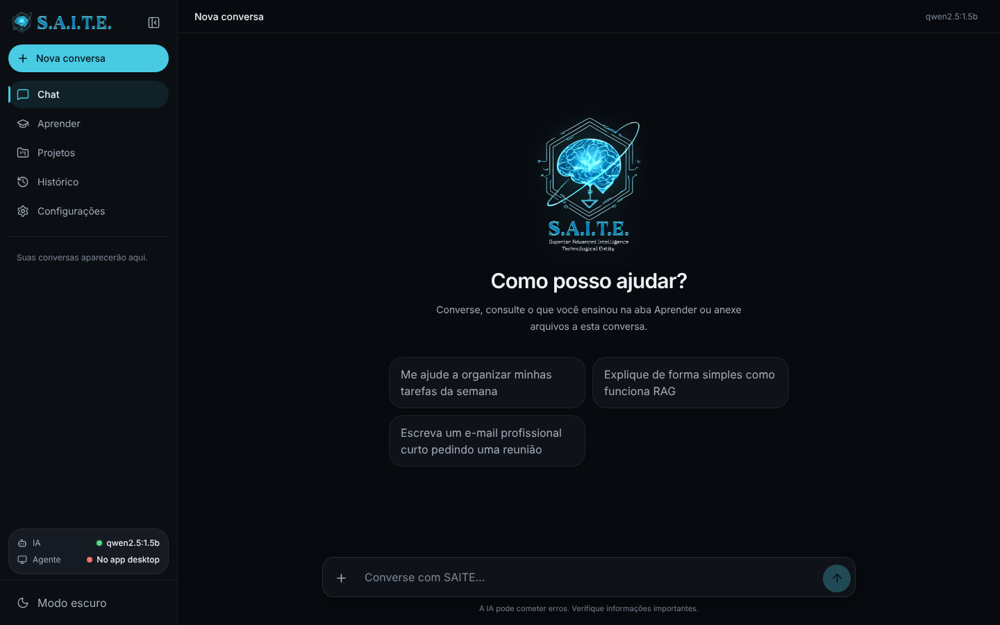

# 🤖 S.A.I.T.E. — Superior Advanced Intelligence Technological Entity

> IA pessoal **local e privada**: conversa com modelos abertos executados no seu computador, aprende com seus
> arquivos e links, organiza projetos independentes e — com sua permissão — consulta o computador em tempo real.
> Nenhuma chave da OpenAI, Anthropic ou outro serviço pago é necessária.



## O que já funciona

| Área | O que faz |
|---|---|
| **Chat** | Conversas persistentes com histórico como contexto, respostas em *streaming*, botão Parar (resposta parcial salva), fixar/renomear/arquivar/excluir, anexos só daquela conversa |
| **Aprender** | Importa PDF, DOCX, TXT, MD, CSV, XLSX, HTML e links públicos; extrai, divide em trechos, gera embeddings locais e indexa; acompanha o processamento; reprocessa, atualiza e remove |
| **Respostas com fontes** | Busca híbrida (palavras + semântica) filtrada por permissão; cita `[n]` com documento, página/seção e trecho; avisa quando nenhuma fonte foi encontrada |
| **Projetos** | Instruções, documentos, memórias e conversas próprios; o contexto de um projeto nunca vaza para outro |
| **Histórico** | Busca por título e conteúdo das mensagens; conversas arquivadas |
| **Agente local** | Processo separado, somente leitura: sistema, discos, listar/procurar/ler arquivos **apenas** nas pastas que você autorizar, com auditoria e pausa |
| **Configurações** | Estado real do runtime e do agente, modelos instalados, teste do modelo, permissões, memórias, exportação/importação |

O que ainda **não** existe (e por quê) está em [Limitações](#limitações).

## Arquitetura em uma linha

`Navegador → Backend FastAPI (no seu PC) → Ollama/llama.cpp + SQLite (FTS5 + embeddings) + agente local`

A interface pode rodar localmente ou na Vercel (https://saite-agent.vercel.app); em ambos os casos é **o seu
navegador** que fala com `localhost` — os dados não passam por servidores de terceiros.
Detalhes: [docs/ARQUITETURA.md](docs/ARQUITETURA.md).

## Início rápido

Pré-requisitos: Python 3.11+, Node 20+, [Ollama](https://ollama.com/download). Guia completo (Windows/macOS/Linux,
variáveis, backup, problemas comuns): [docs/INSTALACAO.md](docs/INSTALACAO.md).

1. Modelos locais (~4,7 GB + ~1,2 GB; para máquinas modestas use `qwen2.5:1.5b`):

```bash
ollama pull qwen2.5:7b
```

```bash
ollama pull bge-m3
```

2. Backend (terminal 1):

```bash
cd backend && python -m venv venv && source venv/bin/activate && pip install -r requirements.txt && cp .env.example .env
```

```bash
uvicorn app.main:app --host 127.0.0.1 --port 8000
```

No Windows: `venv\Scripts\activate` e `copy .env.example .env`.

3. Interface (terminal 2):

```bash
cd frontend && npm install && npm run dev
```

Abra http://localhost:3000.

4. Opcional — agente do computador (terminal 3): veja [agent/README.md](agent/README.md).

## Estrutura

```
backend/   API FastAPI: chat, RAG, projetos, SQLite, provedores de IA (app/), testes (tests/), avaliação RAG (eval/)
agent/     Agente local do computador (permissões, ferramentas somente leitura, auditoria)
frontend/  Interface Next.js 16 + React 19 + Tailwind 4 (src/), testes ponta a ponta (e2e/)
docs/      Diagnóstico, arquitetura, instalação, segurança, avaliação, capturas e relatório técnico em PDF
```

## Qualidade verificada

| Verificação | Resultado |
|---|---|
| Backend (`pytest`) | 81 testes aprovados |
| Agente (`pytest`) | 17 testes aprovados |
| Interface (lint, tipos, build) | sem erros |
| Ponta a ponta (Playwright + axe, sistema real) | 13/13 cenários; sem violações WCAG A/AA sérias |
| Avaliação RAG (`qwen2.5:7b` + `bge-m3`) | recuperação 100%, fidelidade 100%, precisão das citações 100% |
| Dependências (`npm audit`, `pip-audit`) | 0 vulnerabilidades conhecidas |

Relatório completo: [docs/RELATORIO_TECNICO_SAITE.pdf](docs/RELATORIO_TECNICO_SAITE.pdf).

## Limitações

- Precisa de um runtime local (Ollama ou compatível) e de hardware compatível com o modelo escolhido; em CPU sem GPU, o 7B leva ~10–25 s por resposta.
- Modelos pequenos (≤1,5B) raramente citam fontes e quase não usam ferramentas; podem afirmar coisas sem base — a interface sinaliza quando nenhuma fonte foi usada.
- Sem OCR para PDFs digitalizados, sem voz e sem integração com Google Drive (botões que não funcionavam foram removidos).
- Um único usuário local; o token de API é opcional (recomendado se a porta for exposta).
- O agente não executa ações que alteram o computador (somente leitura, por decisão de segurança).
- "Aprender" significa base de conhecimento consultável (RAG), não treinamento dos pesos do modelo.

## Roadmap

OCR (Tesseract), voz local (whisper.cpp + Piper), fila de ingestão persistente, índice vetorial dedicado para
grandes volumes (`sqlite-vec`/Qdrant), reranking, empacotamento desktop (Tauri) com backend e agente embutidos,
cliente mobile, e — somente com objetivo e dados definidos — fine-tuning (LoRA) de um modelo aberto.

## Regras para continuar o projeto

1. Não recriar o projeto; manter Next.js no frontend e FastAPI no backend.
2. Rotas finas; regras em `services/`; IA sempre atrás de `LLMProvider`.
3. Nenhuma chave de API no frontend ou no Git; nada de dependência obrigatória de IA paga.
4. Ferramentas do computador só pelo agente local, com permissão explícita e auditoria.
5. Toda funcionalidade nova com teste e estado real na interface (sem dados simulados).
